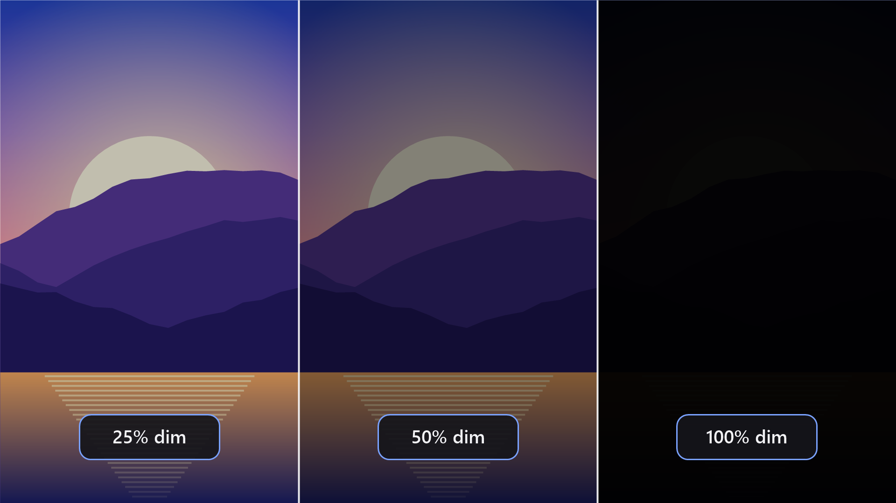
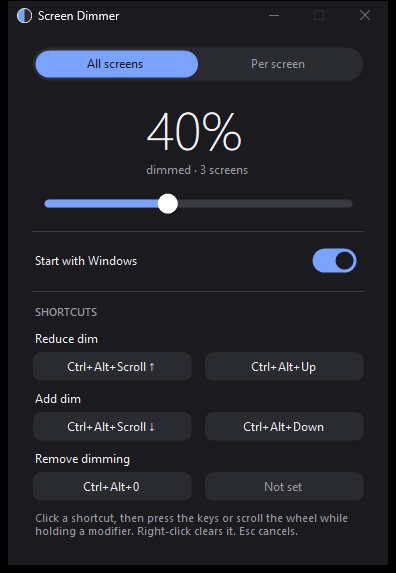
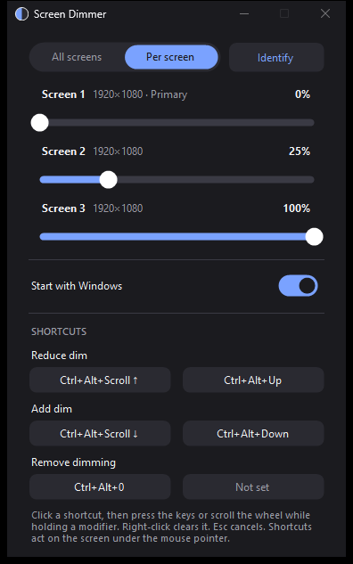

# Screen Dimmer for Windows

**Dim every screen, each on its own, below the lowest brightness your monitor offers.**

Screen Dimmer puts a soft, click-through black layer over your displays. It works on everything
Windows can show: your laptop panel, monitors on HDMI or DisplayPort, and even screens on USB or
DisplayLink adapters that ignore the brightness buttons. Choose how dark, from 0% (off) to 100%
(nearly black).

> **Status:** Microsoft Store listing in preparation. The link will appear here.
> It will be a small one-time purchase, about the price of a coffee. If it saves your night's sleep (or
> someone else's), that is the idea.

## Why it exists

> My wife and our kid sleep in the room where I work at night. My laptop and monitors let me turn the
> brightness down, but it was never enough. A flashing YouTube video lit up the room and kept them awake.
> I couldn't find a tool that did what I needed, so I built one.
>
> Now I write in a dark theme on the bottom screen while a video plays, dimmed, on the top one.

## What it does

- **One slider for all screens**, or **a separate level for each screen**, for example 100% on one, 20% on
  another and 0% on a third.
- **Ctrl+Alt + mouse wheel**: scroll up to reduce dim, down to add dim. In per-screen mode it changes the
  screen under your mouse pointer.
- **Rebindable shortcuts**: any modifier plus a key, or plus the wheel.
- **Tray icon** with presets (25%, 50%, 75%, 90%) and a quick switch between the two modes.
- **Identify** shows a big number on every screen, so you know which slider is which.
- **Starts with Windows** (optional), and waits quietly in the tray.
- **Remembers each monitor's level**, even after you unplug it, and notices monitors plugged in or removed.
- **No account, no ads, no network access, no data collected.**

<table>
<tr>
<td></td>
<td></td>
</tr>
<tr>
<td align="center">One slider for every screen</td>
<td align="center">A level for each screen</td>
</tr>
</table>

## Quick start

1. Open Screen Dimmer and drag the slider.
2. Want different levels? Choose **Per screen**, and select **Identify** if you are not sure which screen is
   which.
3. Hold **Ctrl+Alt** and scroll the mouse wheel to change the level without opening anything.
4. Close the window. It keeps running in the tray. Right-click the tray icon to quit.

Full details: **[User guide](USER-GUIDE.md)**.

## Good to know

- It darkens the picture; it does **not** change the monitor's backlight or power use. For the best
  result, turn the monitor's own brightness down first, then use Screen Dimmer for the rest.
- Screenshots and recordings capture the dimming too.
- Programs in exclusive full-screen mode (some games) can draw above the dimming layer. Borderless-window
  mode works.
- 100% is about 97% black, so a screen is never switched fully off. Ctrl+Alt+0 or the tray menu's
  **No dimming** always brings it back.

## Privacy

Screen Dimmer collects nothing and sends nothing. Read the short **[privacy policy](PRIVACY.md)**.

## Support and feedback

Questions, bugs or ideas? [Open an issue](../../issues). Please do not post personal information.
The application's source code is not published in this repository; it holds the public
documentation, screenshots and the privacy policy only.

## License

Documentation and images © 2026 q-sag, all rights reserved (see [LICENSE](LICENSE)).
